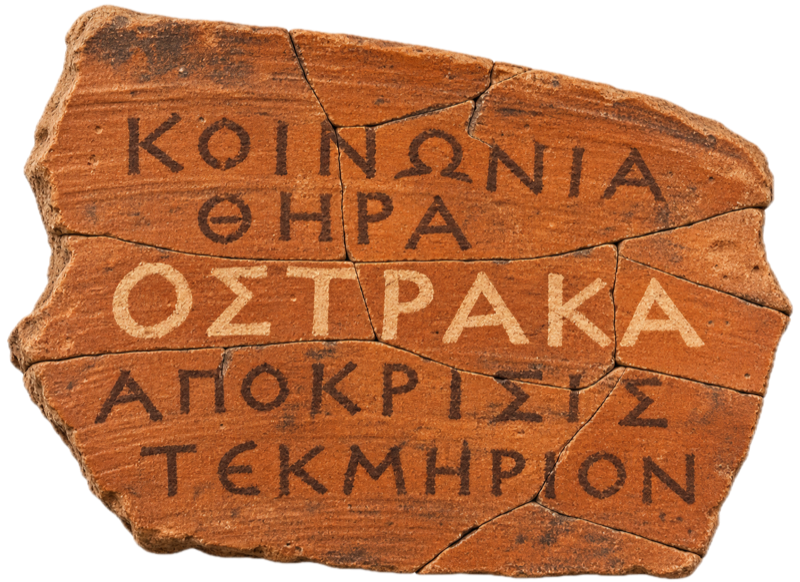

<p align="center">
  
</p>

<h1 align="center">Ostraka</h1>

<p align="center"><strong>Incident management and response for teams</strong></p>

<p align="center"><em>Operational Suite for Teams to Respond, Assess, Keep records &amp; take Action</em></p>

Ostraka is where a team runs an incident:
- who's involved and who's doing what;
- the tasks handed to a team or a person, with nudges when they stall;
- the IOCs, assets and findings, and how they connect;
- the assessments that go to leadership.

The name is Greek: *ostraka* are the broken pieces of pottery the ancient world wrote on, everyday receipts and accounts in Egypt and ballots in Athens. A record, a ledger and a decision taken by many hands. Ostraka was called ciphr until November 2026; [docs/BRAND.md](docs/BRAND.md) has the story and the brand.

It's built to sit beside [Rowanholt](https://github.com/cmdaltr/rowanholt), which handles evidence and analysis, and [Shikari](https://github.com/cmdaltr/shikari), which handles detection and hunting.

> **Status:** being rebuilt. Phases 0 to 3a are in place: the foundations; accounts, teams, invitations, mandatory MFA and API tokens; the incident core (incidents and roles, observables, assets, findings that need a verification before they're confirmed, threaded comments, a hash-chained activity log, the timeline and live presence); the work (tasks for a team's queue or a person, checklists, playbooks, nudges, reminders that escalate to the team lead and then the incident commander, and notifications in Ostraka, by browser push, by email and in a team's Microsoft Teams channel); and hunts (HNT-YYYY-NNN, Hypothesis → Collect → Analyse → Conclude, promoted to an incident when they find something), links between records, subtasks, tasks that wait on other tasks, and workflow playbooks with decisions and hand-offs between teams. Built ahead of phase 4: assessments in the reporting standard's structured parts, analysis of competing hypotheses, lessons learned, and exports as a full technical report or a briefing in PDF and Word. Ostraka comes in Free, Pro and Services editions, set by a signed licence that an admin installs after accepting the commercial terms: Pro adds report branding and signed webhooks, and Services adds a brand per client and the right to run Ostraka for clients. Phase 3b, the desktop apps, packages and scripts, is being built.

## Install

The desktop apps run Ostraka on your computer or connect to your team's server. Download the file for your machine from the releases page:

| File | For |
|---|---|
| `Ostraka-<version>-macos-universal.dmg` | Macs, Apple silicon and Intel |
| `Ostraka-<version>-windows-universal.msi` | Windows 10 and 11, x64 and ARM64 |
| `ostraka_<version>-1_all.deb` | Ubuntu 22.04 or later, Debian 12 or later, any architecture |
| `ostraka-<version>-source.tar.gz` | A team server, or any other Linux (Rocky, RHEL, Alma, Fedora): `install.sh` puts it in `~/Ostraka` and adds Ostraka to your applications menu |
| `SHA256SUMS` | Checksums of the above, which the install scripts check |

Running it locally needs Docker (OrbStack or Docker Desktop on macOS, Docker Desktop on Windows, Docker Engine on Linux). The install scripts pick the right file for the machine and check it against SHA256SUMS before installing anything:

```bash
sh install.sh                                              # macOS and Linux
powershell -ExecutionPolicy Bypass -File install.ps1      # Windows
sh uninstall.sh            # add --data to remove the incident database too
```

How the apps, packages and scripts fit together is in [desktop/README.md](desktop/README.md).

## Run it

You need Docker with Compose. From a checkout, the `ostraka` command writes `.env` with random secrets, builds and starts the stack, and waits until it answers:

```bash
./ostraka start
./ostraka first-admin you@example.org
./ostraka status
```

There is no default account and no self-registration. `first-admin` prints a one-time link for the first admin (`make env` and `make up` still work, with `docker compose exec backend ostraka bootstrap-admin you@example.org`). Open it, choose a password, scan the QR code with an authenticator app, and save your backup codes. Every sign-in needs the authenticator. After that, admins and team leads invite everyone else from **People**.

### Notifications

Everything appears under the bell in Ostraka. To also send email, set the `OSTRAKA_SMTP_*` values in `.env` (see `.env.example`). Browser push needs no setup: each person turns it on under **Profile → Notifications**, where they also choose which kinds reach them outside Ostraka and set quiet hours (read in their own time zone; work on a critical incident still comes through). It works wherever Ostraka is served over HTTPS (or on `127.0.0.1`). A team's lead connects its Microsoft Teams channel in **People**, with the URL from the channel's Workflows webhook ("Post to a channel when a webhook request is received").

#### Email through Microsoft Graph

Graph sends as one mailbox in a work or school Microsoft 365 tenant; personal Microsoft accounts can't use it.

1. In Entra ID, register an app (single tenant) and add a client secret. Don't add any API permissions: Exchange grants the one it needs, limited to one mailbox, in step 2.
2. In Exchange Online PowerShell, let the app send only as Ostraka's mailbox:

   ```powershell
   New-ServicePrincipal -AppId <client-id> -ObjectId <enterprise-app-object-id> -DisplayName "ostraka"
   New-ManagementScope -Name "ostraka sender" -RecipientRestrictionFilter "PrimarySmtpAddress -eq 'ostraka@yourdomain'"
   New-ManagementRoleAssignment -App <client-id> -Role "Application Mail.Send" -CustomResourceScope "ostraka sender"
   ```

   Granting Mail.Send in Entra instead would let the app send as anyone in the tenant.
3. In `.env`, set `OSTRAKA_MAIL_TRANSPORT=graph` and the four `OSTRAKA_GRAPH_*` values, then `docker compose up -d backend`.

A secret expires (24 months at most); put its renewal in the calendar.

What leaves Ostraka is cut down first: indicators are masked, and for TLP:RED and TLP:AMBER+STRICT incidents only the reference and the kind of event are sent.

### A team server

On Linux, one script installs the stack, writes its secrets and prints the first admin's link; `--caddy` adds HTTPS in front:

```bash
sudo ./deploy/linux/install.sh ostraka.example.org --admin you@example.org --caddy
```

On Windows Server it runs under WSL 2: `.\deploy\windows\install-service.ps1 -Url ostraka.example.org -Admin you@example.org -InstallDocker`. Examples for an existing reverse proxy (Caddy or nginx) are in [deploy/README.md](deploy/README.md).

### The responder client

`clients/ost` (Bash) and `clients/ost.ps1` (PowerShell) work an incident from a terminal, with an API token from Profile → API tokens:

```bash
ost login https://ostraka.example.org
ost declare "Beacon from WS042" --severity high --tlp amber
pbpaste | ost ioc add OST-2026-001
ost comment OST-2026-001 "Isolated"
ost tasks --mine
```

### Behind a proxy you already run

Ostraka publishes one port, `127.0.0.1:24747`, and expects TLS in front of it: a reverse proxy, or Caddy from `deploy/linux/install.sh --caddy`. A tool that redeploys it can ask `GET /api/busy` first, which says whether a restart would interrupt anyone.

### Sample data and importing

```bash
docker compose exec backend ostraka import --sample          # four incidents and three hunts, tagged "sample"
docker compose exec backend ostraka import --remove-sample   # and gone again
docker compose exec backend ostraka import records.json      # your own, in the ostraka-import/1 format
```

The sample is a fictional freight company's fortnight: a ransomware incident with cross-team tasks that wait on each other, an invoice-fraud incident that shows verified, refuted and graded findings, a Kerberoasting hunt promoted to an account-compromise incident (linked as the ransomware's child), a closed data exposure, and two hunts at different stages. The ransomware incident carries assessments (one superseding another), an ACH matrix rated by three analysts with a rejected hypothesis, and lessons learned, so its reports show every section. Its 21 people (three or more in every team) can't sign in, and nothing is emailed or pushed. The format is documented at the top of `backend/ostraka/importer.py`, and `backend/ostraka/samples/sample.json` is a worked example.

Only the web container publishes a port. Postgres and Redis are reachable only on the compose network.

### Reports

An incident or hunt exports from its page (Export) as the full technical report or a shorter briefing, in PDF or Word, in the Ostrakon palette (or your brand, with a Pro or Services licence) with the TLP on every page. Set `OSTRAKA_ORGANISATION` to name who reports are prepared for. Exports are open to people who worked on the incident; tick Sensitive on its overview and only the commander can export. The PDF embeds Inter and JetBrains Mono; Word names them and substitutes its own fonts on a machine without them.

### Editions and licences

Without a licence, Ostraka is the free edition: four people who can sign in, one of them an admin or team lead, with reports in the Ostrakon palette. A Pro licence sets the number of seats and lets reports carry your colours and logos; a Services licence, for MSSPs and consultancies, adds a brand per client, chosen on each incident, and the right to run Ostraka for clients. An admin installs a licence under Installation, or on the server:

```bash
docker compose exec backend ostraka licence install /path/to/licence.txt
docker compose exec backend ostraka licence show
docker compose exec backend ostraka licence remove   # back to free; nobody is deactivated
```

Licences are checked offline. One that runs out keeps working for 30 days, then Ostraka goes back to the free edition without deactivating anyone.

Issuing a licence needs the signing key, which never goes on a server:

```bash
export OSTRAKA_LICENCE_KEY=~/.config/ostraka/licence-signing.key
./scripts/admin/issue-licence.sh "Northwind Ltd" services 25 ops@northwind.example 2027-11-30
```

The model shared with Shikari and Rowanholt, and what each edition unlocks, is in `docs/LICENSING_MODEL.md`.

### MCP

Ostraka answers MCP itself at `/mcp` (streamable HTTP), so an MCP client needs only a URL and an API token from Profile → API tokens, which shows the command once the token is made:

```bash
claude mcp add --transport http ostraka https://ostraka.example.org/mcp \
  --header "Authorization: Bearer ost_..."
```

Every tool calls Ostraka's own API as the token's owner, so it sees what they see, with indicators masked as they are for them. A read-only token is offered the read tools: `list_records`, `get_record`, `findings`, `observables`, `assets`, `tasks` (with the playbook workflows), `timeline`, `comments`, `activity` (with the hash chain's check), `my_tasks`, `look_up` and `whoami`. A full token also gets `add_comment` and `add_lead`; a lead is never confirmed, since only an analyst confirms a finding. TLP:RED and TLP:AMBER+STRICT records don't reach an MCP client, whose model may not be local: they're listed by reference and status only.

## Develop

```bash
cd backend && python3.12 -m venv .venv && .venv/bin/pip install -e '.[dev]'
cd frontend && npm install
make dev-backend    # :6176, needs Postgres and Redis
make dev-frontend   # :5173, proxies /api to :6176
make check          # lint, unit, database (throwaway Postgres) and e2e tests
```

The backend is FastAPI with Postgres 16 (schema managed by Alembic only) and Redis. The frontend is React, TypeScript and Vite, styled with CSS design tokens and three palettes (Cobalt by default, then Ostrakon and Ledger), each in light and dark. `/design` shows the live design system.

How it fits together, with diagrams, is in [docs/ARCHITECTURE.md](docs/ARCHITECTURE.md). Conventions for contributors, human or AI, are in [.claude/CLAUDE.md](.claude/CLAUDE.md).

## Licence

Copyright (c) 2026 cmdaltr. Ostraka is licensed under the [Elastic License 2.0](LICENSE): you can use, copy and change it, but not provide it to others as a hosted or managed service or get around its licence key. The Pro and Services editions add the terms in [COMMERCIAL-LICENSE.md](COMMERCIAL-LICENSE.md). Outside contributions need a contributor licence agreement before they can be merged.

**By downloading, installing or using Ostraka, you agree to the [Elastic License 2.0](LICENSE), and, where you install a Pro or Services licence key, to the terms in [COMMERCIAL-LICENSE.md](COMMERCIAL-LICENSE.md). If you do not agree, do not install or use the software.** This is why the installers don't stop to ask: the terms ship with every package (the `.deb`'s `copyright` file, `LICENSE` in every other package and in the source tree, and in-app under Help → Licence), and use is what signifies acceptance. Installing a licence key is the exception: an admin accepts the commercial terms there, on the Installation page or with `ostraka licence install --accept-terms`, and Ostraka records who accepted, when and which version.

**Ostraka™** and its logo are trademarks of cmdaltr. The licence covers the software; it grants no right to use the name or logo, whether to brand a fork or otherwise.
