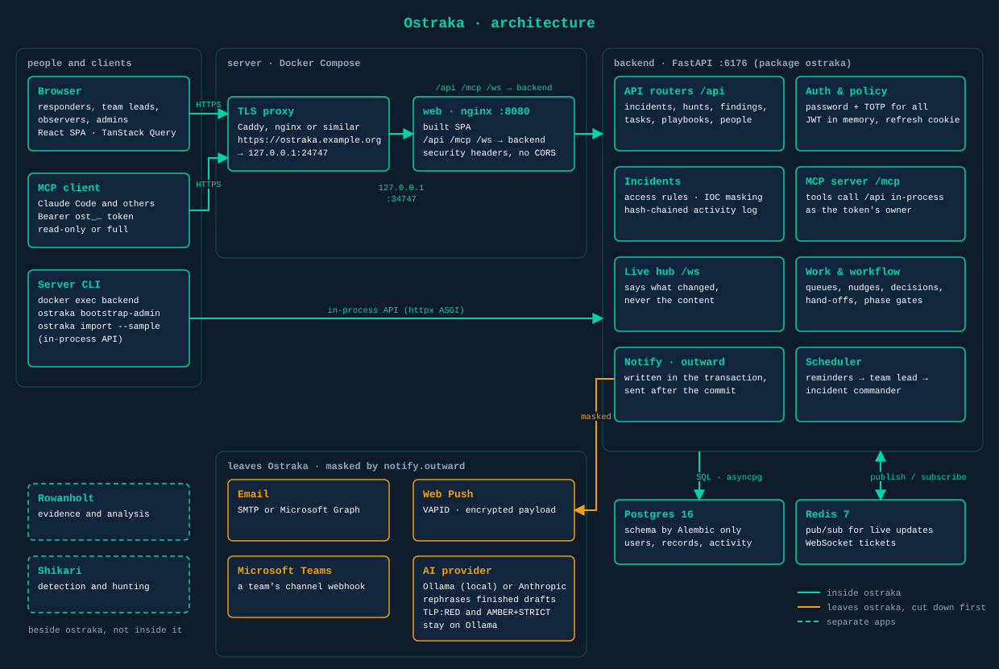
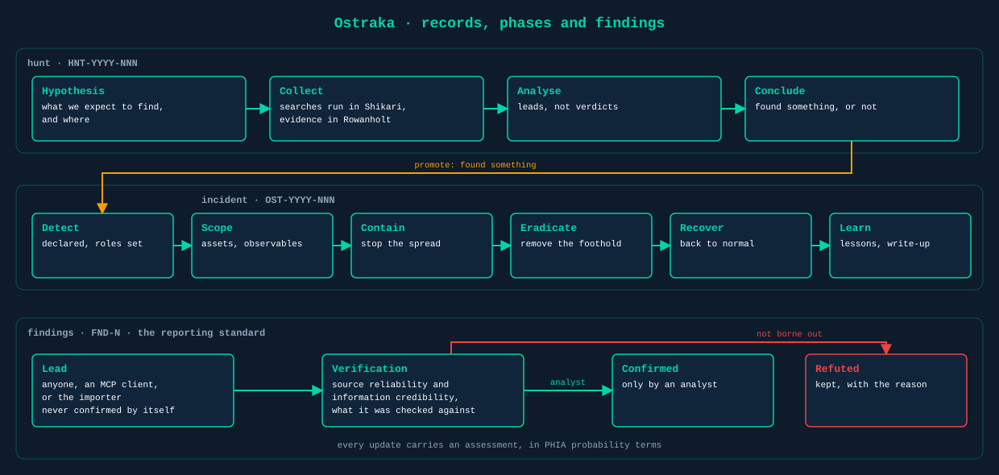
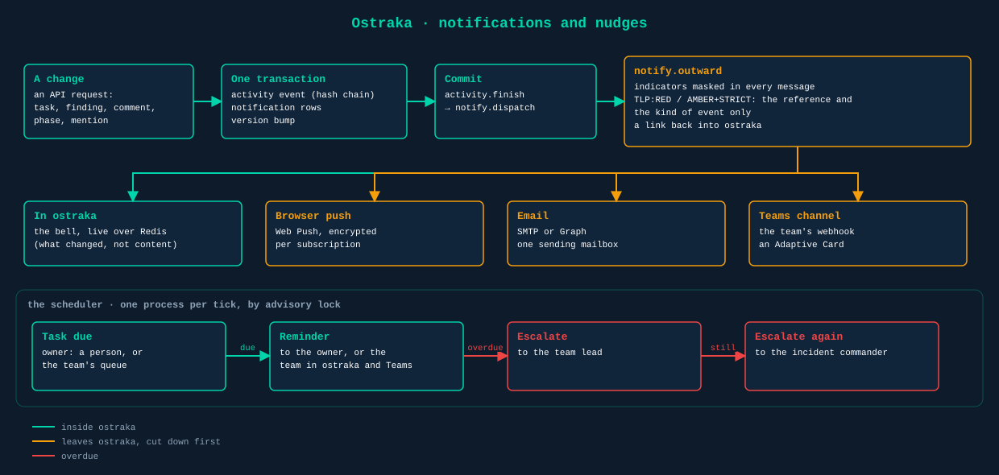
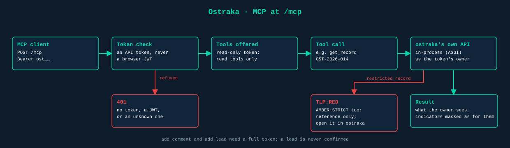
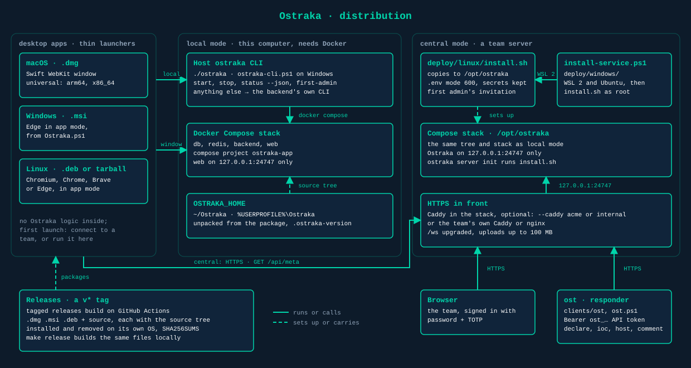

# How Ostraka fits together

Ostraka is one FastAPI service, one React single-page app, Postgres and Redis, run with Docker Compose. Only the web container publishes a port. The decisions behind each part are in [ROADMAP.md](ROADMAP.md); the conventions are in [../.claude/CLAUDE.md](../.claude/CLAUDE.md). `python3 docs/diagrams/draw.py` redraws the diagrams below.

## The stack



Every request reaches the backend through one origin. A reverse proxy in front terminates TLS and forwards to the web container on the host's loopback, `127.0.0.1:24747`. nginx serves the built SPA and proxies `/api`, `/mcp` and the `/ws` live socket to the backend. There's no CORS: the browser never talks to anything but its own origin (Vite's proxy does the same job in development).

| Part | Where | What it does |
|---|---|---|
| API routers | `backend/ostraka/api/` | Incidents and hunts, findings, observables, assets, tasks, playbooks, comments, people, teams, tokens, notifications |
| Auth and policy | `ostraka/auth/` | Passwords (Argon2), mandatory TOTP and backup codes, short-lived JWTs held in memory, a rotating refresh cookie, API tokens (`ost_…`). Who may do what is in `policy.py`, as pure functions |
| Incidents | `ostraka/incidents/` | Access rules, the hash-chained activity log, IOC masking per viewer, #references |
| MCP server | `ostraka/mcp_server.py` | MCP at `/mcp`: each tool calls the API in-process as the token's owner |
| Live hub | `ostraka/live.py` | WebSocket fan-out over Redis pub/sub. A message says what changed, never the content; clients refetch through the API, which masks per viewer |
| Work and workflow | `ostraka/work.py`, `ostraka/workflow.py` | Task ownership, team queues, subtasks and blocking; playbook steps that wait, open at a phase or follow a decision |
| Notify | `ostraka/notify/` | Notifications written in the transaction and sent after the commit, through `notify.outward` |
| Scheduler | `ostraka/scheduler.py` | Reminders and escalation, one process per tick by Postgres advisory lock |
| Importer | `ostraka/importer.py` | `ostraka import`: records loaded through the API, replayed in time order |
| Frontend | `frontend/src/` | React, TypeScript, TanStack Query. `api/client.ts` is the only way to call the API; colours come only from `styles/tokens.css` |

Postgres holds everything; its schema changes only through Alembic (`backend/migrations/`), and every revision must upgrade, downgrade and upgrade again. Redis carries live updates and the short-lived WebSocket tickets, and nothing else.

## Records, phases and findings



A record is an incident (`OST-YYYY-NNN`) or a hunt (`HNT-YYYY-NNN`), the same table with a `kind`. Hunts run Hypothesis → Collect → Analyse → Conclude; a hunt that finds something is promoted, which declares an incident linked to it. Incidents run Detect → Scope → Contain → Eradicate → Recover → Learn.

Findings (`FND-N`) start as leads. A lead can come from anyone, from an MCP client or from the importer, and it is never confirmed by itself: confirmation needs a verification (source reliability, information credibility, what it was checked against) and an analyst. A refuted finding is kept, with the reason. Every update carries an assessment in the PHIA yardstick's probability terms. All of this is enforced by Ostraka's own structure, not by AI.

## Assessments, ACH and lessons

An assessment (`ASM-N`) is stored as parts: the claim, a yardstick term, the findings it rests on, and negative evidence, each piece of which names the search that came back empty (platform, query, scope, window). `ostraka/standard/` turns the parts into sentences, bottom line first and strongest evidence first ("We assess it is likely (55–75%) that ..."), and lints them with fixed rules. An error (no basis, a refuted finding cited, "almost certain" resting only on leads) stops the save. A warning (certainty words, loaded adjectives, likelihood written into the claim, the author writing "we assess" themselves) is saved and shown. Assessments are never edited: a new one supersedes the old, so the record shows how the judgement moved.

Analysis of Competing Hypotheses keeps hypotheses (`HYP-N`), evidence (`EVD-N`: a finding, an observable, an assumption, or something absent) and each analyst's C, I or N/A rating, up to eight analysts per matrix. The arithmetic in `standard/ach.py` is weighted inconsistency (I counts −1 × credibility × relevance, with H 1.414, M 1 and L 0.707), averaged across analysts; the open hypothesis nearest zero leads. It flags evidence that can't tell the hypotheses apart, cells where analysts disagree, and evidence whose removal would change the lead. Rejecting a hypothesis needs a reason, and the score and algorithm at that moment go into the activity chain. A hypothesis's milestone (what would change our view) and a lesson to improve (`LSN-N`) can each become a task.

## Reports

`GET /api/incidents/{id}/export?variant=report|briefing&format=pdf|docx` renders the record at that moment through `ostraka/reports/`: `incident.py` decides what the technical report and the briefing say, as blocks, and `branded.py` renders the blocks to PDF (reportlab, with Inter and JetBrains Mono embedded) or Word (python-docx) in the Ostrakon palette or the installation's brand (see Editions), with the TLP on the cover and every page. The technical report defangs network indicators and quotes queries exactly; the briefing masks indicators as Ostraka does for observers. Only people who worked on the incident (a role in it, or something recorded in it) may export, and only the commander when it's marked sensitive (`policy.can_export`). Each export goes into the security log and the incident's activity chain.

## Editions and report brands

`ostraka/licence.py` reads the installed licence (`licences` table, newest not removed): a line `ostraka-licence-1.<payload>.<signature>` in the format shared with Shikari and Rowanholt (`docs/LICENSING_MODEL.md`), Ed25519-signed, checked against `PUBLIC_KEYS` with no network call. `standing()` turns it into the edition and features in force (free; pending before `not_before`; the licence's edition while active and for 30 days' grace), and code asks `standing.has(feature)`. `accounts.places_held` counts the places taken (active accounts with a usable password, plus open invitations that would add one) and `policy.seat_refusal` decides; inviting, re-enabling someone, giving an imported person access and `bootstrap-admin` beside a live admin all check it, and refuse with 402. Accepting an invitation doesn't: its place was taken when it was sent.

A report brand (`report_brands`) holds a primary and optional secondary colour and up to three logos. `reports/theme.py` derives the full palette, darkening the primary until text in it passes 4.5:1 and the secondary to 3:1, and holds the theme in force in a context variable, which follows a render into its worker thread. `reports/brands.py` cleans uploads (PNG or JPEG only, a pixel limit before decoding, redrawn as a fresh PNG) and picks an export's styling: the incident's own brand under Services, the default brand under Pro or Services, else Ostrakon. Brand changes are admin-only and audited.

## Notifications and nudges



A change writes its activity event and its notification rows in the same transaction. Nothing leaves until the commit: `activity.finish` calls `notify.dispatch`, and everything that goes outside Ostraka passes through `notify.outward` first. Indicators are masked in every email, push and Teams card, and a TLP:RED or TLP:AMBER+STRICT record is named by its reference and the kind of event only.

Every notification appears under the bell. Whether it also goes out by push or email is decided per person at delivery (`profile.outside_channels`): a kind they've muted stays in Ostraka, and quiet hours, read in their own time zone, hold everything back except work on a critical incident. A sign-in from a browser the account hasn't used before (`new_device`) follows its own switch and ignores quiet hours, since it may be the only sign someone else has the password.

The scheduler reminds a task's owner (a person, or a team's queue) when it's due, then escalates to the team lead and then to the incident commander. The intervals are settings; the agreed defaults are in the roadmap.

## MCP



`/mcp` takes API tokens only, never a browser session. A read-only token is offered the read tools; a full token adds `add_comment` and `add_lead`. Each tool calls Ostraka's own API in-process as the token's owner, so it sees exactly what they would in the browser, masked the same way. Restricted TLP records are listed by reference and status, and the detail tools refuse them.

## Distribution



Every way of running Ostraka is the same compose stack. The host `ostraka` command (`./ostraka`, and `desktop/windows/ostraka-cli.ps1` on Windows) wraps `docker compose` in a source tree: `start` writes `.env` with random secrets the first time and waits for `GET /api/health`, `status --json` and its exit codes tell a launcher whether Docker and the stack are up, `first-admin` prints the first invitation link, and anything it doesn't know goes to the backend's own CLI. The desktop apps are thin launchers over that command, on Rowanholt's pattern: a Swift WebKit window on macOS, Edge in app mode from `Ostraka.ps1` on Windows, and Chromium, Chrome, Brave or Edge in app mode on Linux. None of them holds any of Ostraka's logic; `desktop/README.md` is the contract they share.

On first launch the app runs in one of two modes, with no sync between them. Central mode connects to a team's server: the address must answer `GET /api/meta` with `"name": "Ostraka"` over HTTPS the OS trusts, and the app is then a window onto it with nothing stored locally. IT can set the server (an MDM profile, `/etc/ostraka/client.json`, or the `Policies` registry key), which locks it. Local mode runs the stack on this computer, bound to 127.0.0.1, and needs Docker; the app never installs Docker itself. Both modes sign in the same way, password and TOTP, and Help → Licence opens the server's public `/help/licence`, which reads `GET /api/legal`, so it shows what that installation ships.

A package carries the source tree for its version: `desktop/source-tarball.sh` is `git archive HEAD` under one top folder, `ostraka-<version>/` (the `.msi` carries it as `source.zip`). On the first local run the launcher unpacks it into `OSTRAKA_HOME` (`~/Ostraka`, or `%USERPROFILE%\Ostraka`) and writes `.ostraka-version`. The CLI sees that marker and runs the tree as compose project `ostraka-app`, so an installed copy never shares volumes with a checkout called `ostraka`. A newer app offers to update the files in place and leaves `.env` and the volumes alone; a git checkout is never overwritten. A team server is the same tree set up by `deploy/linux/install.sh` (or `deploy/windows/install-service.ps1`, which runs it under WSL 2), with Caddy in the stack or the team's own reverse proxy in front of 127.0.0.1:24747.

Tagged releases build on GitHub Actions, as Rowanholt's do. Pushing `v<version>` runs `.github/workflows/desktop-release.yml`: one job makes the source tarball, then the `.dmg` builds on a macOS runner, the `.deb` on Ubuntu, and the `.msi` with `wixl` on Ubuntu before a Windows runner signs it when there's a certificate. Each package is installed and uninstalled with the same `install` and `uninstall` scripts a user runs, on its own OS, checking the files, the bundle id or menu entry or Windows Installer registration, and that nothing is left behind; the stack isn't started and no window opens. The files go with SHA256SUMS onto a draft release, published by hand. A manual run builds `<version>-dev.<run>` and leaves the files as workflow artifacts. Signing and notarisation switch on with the secrets listed in `desktop/README.md`.

The same files build locally, from one Mac with Docker:

```bash
make release VERSION=0.1.0
make release VERSION=0.1.0 UPLOAD=1
```

`scripts/release.sh` refuses a version that isn't `backend/ostraka/__init__.py`'s and a tree with uncommitted changes, makes the source tarball once, and passes it to each packager as `--version V --source TARBALL OUTDIR`: one package per platform, for every architecture, named as Rowanholt's are. `Ostraka-<v>-macos-universal.dmg` holds a universal binary (arm64 and x86_64, so it needs macOS), `ostraka_<v>-1_all.deb` is built with `dpkg-deb` where it's installed or in a Debian container, and `Ostraka-<v>-windows-universal.msi` with `wixl` in a container. There's no `.rpm`: on a Linux without apt, `install.sh` installs the source tarball into `~/Ostraka` and adds the menu entry. Everything lands in `dist/<version>/` with SHA256SUMS, and `UPLOAD=1` puts it on a draft GitHub release at the pushed commit. `desktop/install.sh` and `desktop/install.ps1` check a download against SHA256SUMS before installing anything.

## Names that stay fixed

Two key-derivation labels still say `ciphr`, on purpose: the one that encrypts TOTP secrets (`auth/secrets.py`) and the one that derives the Web Push key (`notify/push.py`). Changing either would make every stored authenticator unreadable or orphan every browser's push subscription.
