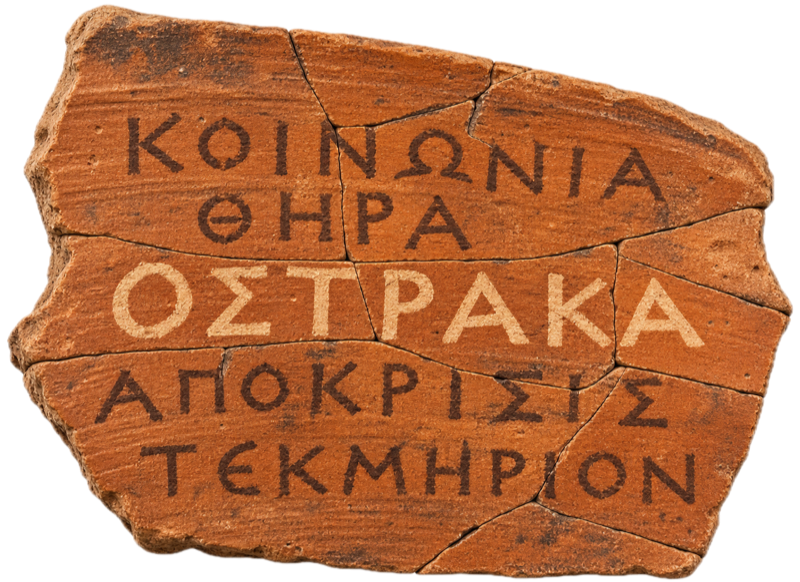
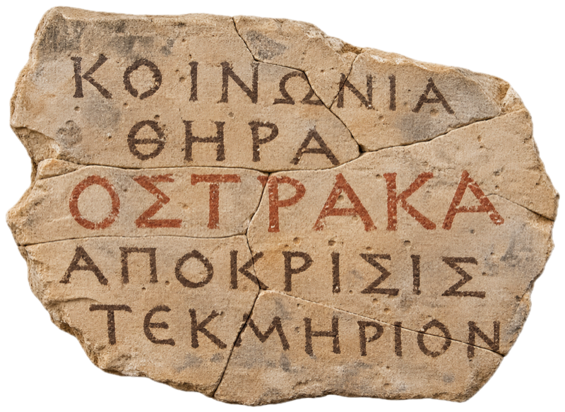

# The Ostraka brand

  
  

## The name

*Ostraka* (Greek ὄστρακα, singular *ostrakon*) are pieces of broken pottery used for writing. In Egypt they were the everyday notepad for centuries: tax receipts, accounts, rotas and letters, from the scribes of Deir el-Medina to the Greek receipts of the Ptolemies. In Athens, citizens scratched a name on one to vote. Egyptologists use the Latin spelling, *ostraca*; *ostraka* is the direct transliteration of the Greek.

That gives the product three meanings in one word: the record, the ledger, and a decision taken by many hands. The broken-and-mended mark adds a fourth: an incident is rebuilt from its pieces, finding by finding.

The name isn't an acronym. Say it OS-tra-ka.

The product was called ciphr until 10 November 2026. CIPHR Ltd, a UK HR software company, holds registered marks for the name, so it changed before anything was released.

## The mark

A single sherd broken into pieces and glued back together, the joins still showing. The writing runs across the breaks, so it only reads once the pieces are rejoined. The words are what Ostraka does, in Greek that existed 2,400 years ago:

| Greek | Meaning |
|---|---|
| ΚΟΙΝΩΝΙΑ | partnership, working together |
| ΘΗΡΑ | the hunt |
| ΟΣΤΡΑΚΑ | the name, in the second colour |
| ΑΠΟΚΡΙΣΙΣ | the answer, the response |
| ΤΕΚΜΗΡΙΟΝ | conclusive proof: Aristotle's word for evidence that settles a question, which is what a verified finding is |

The letters are evenly spaced, as Athenian inscriptions were cut *stoichedon*, each letter in its own square of a grid. The rounded E in ΤΕΚΜΗΡΙΟΝ is the lunate epsilon, a real letterform on later ostraka.

There are two versions:
- **Clay** (fired terracotta, brown ink, the name in pale slip) in the light theme.
- **Limestone** (a pale flake, brown ink, the name in red ochre, like the Egyptian receipts) in the dark theme.

The mark changes material with the theme, so it always stands out from the page. Below about 48 pixels the photograph turns to mush, so the favicon (`frontend/public/favicon.svg`) is a flat drawn sherd that follows the same rule.

| File | Use |
|---|---|
| `docs/brand/ostrakon-clay.png`, `ostrakon-limestone.png` | Documents, the README (800 px, transparent) |
| `frontend/public/brand/` | The limestone one behind every page, and the loose fragments (560 px) |
| `frontend/public/favicon.svg` | The browser tab, clay or limestone by the OS theme |
| `frontend/public/favicon.png` | Push notifications (clay, 192 px) |

## Sign-in

The name as an inscription, with the tagline under it, over the whole sherd (below). The lettering (`frontend/src/components/lettering.ts`) is Latin capitals drawn as strokes in the manner of the mark's Greek: even monoline strokes, every letter in a cell of its own as in *stoichedon*, the lunate E, an A with a sloping bar and an angular S. OSTRAKA is in red ochre with its ™ at the top right. Every so often it's scratched out in black chalk (a soot grey in dark mode, where black wouldn't show) and a word from the work is written in its place, stroke by stroke, in iron-gall ink: PHISHING, LATERAL MOVEMENT, KERBEROASTING and so on, of any length. That is scratched out in turn and the name written again, so the name is up for most of the time. With reduced motion the name stays. The clay sherd and the split-flap departures board were taken off sign-in on 15 November 2026.

## Behind every page

The whole limestone sherd lies behind every page, sign-in included, in every palette and mode: large, centred and faint (`--sherd-whole-opacity`, 0.2 in light mode and 0.054 in dark). In the app, loose fragments of the mark drift round the edges above it. The first ciphr's blue gradient and drifting cipher glyphs are gone: sign-in sits on the palette's own ground like every other page.

A line of the same black chalk (`--chalk`, at `--chalk-line-opacity`) is dragged under each page's heading and an incident's head, and above the foot of the page: rough-edged and broken, as chalk is on stone. The line above the foot runs the width of the page's content, not the window. It marks the page's main divisions only; cards and panels keep their plain borders, so the chalk stays a separator and never a frame. Added 16 November 2026.

## Period pigments

Beside red ochre, the colours come from the palette of the scribes and potters who wrote on ostraka (17 November 2026):

| Pigment | Token | Day | Night | Use |
|---|---|---|---|---|
| Red ochre | `--ochre` | `#a33a24` | `#e07a5f` | The brand and what's chosen: the name, active tabs, the page you're on, pressed choices, a record's teams, avatars, the stroke under a heading, Pnyx's flap |
| Egyptian blue, the first made pigment | Cobalt's `--accent` | `#2456a6` | `#7ea6e8` | What you act on in the default palette: buttons, links, focus, the discussion's flap. Ochre's complement |
| Limestone, parchment and iron-gall ink | Cobalt's `--bg`, `--surface`, `--ink` | `#eeeae2`, `#fbf9f5`, `#221e1a` | `#17140f`, `#1f1b16`, `#ece6dc` | The ground of every page in the default palette: warm, as the period wrote on |
| Malachite, ground copper ore | `--ok` | `#2e7d5b` | `#5cc497` | Done, confirmed, benign: finished phases and tasks, sent updates, met clocks, assets from contained on |
| Yellow ochre | `--yellow-ochre` | `#b07f1c` | `#e0b458` | What's current: the phase a record is in (solid), the one it comes to next (outlined), a phase as a label, and what's open now in a playbook drawing |
| Tyrian purple, from the murex shell | `--tyrian` | `#6b2a4f` | `#c27ba4` | Hunts: a hunt's page and card take it as their accent (buttons, links), with its chip and the faint ground of its card |
| Carbon black and limestone | `--chalk`, the sherd | | | The chalk lines and the stone behind every page |

A playbook's team lanes are drawn from the same pigments: Egyptian blue, malachite, yellow ochre, Tyrian purple, verdigris, raw umber, charcoal and madder; whoever runs it is red ochre.

Cinnabar, the period's other famous red, isn't used: it would be read as Critical. Tyrian purple stays small. Yellow ochre marks only what's current, never a warning, so it isn't read as Medium severity's amber-brown.

## The Ostrakon palette

One of the three palettes in Settings, beside Cobalt (the default) and Ledger. No black anywhere: text is iron-gall brown, the ground is limestone, and fired clay is the accent.

| Token | Light | Dark |
|---|---|---|
| `--bg` | `#f1ede4` limestone | `#1e1612` fired clay at dusk |
| `--surface` | `#faf7f1` | `#271d18` |
| `--ink` | `#33241b` iron-gall | `#efe6d8` |
| `--accent` | `#a0492f` clay | `#e08d6d` |

Severity and TLP colours never change with the palette; TLP chips keep the standard black ground.

## Rules

- Records stay records and findings stay findings: the imagery is in the brand, not in the product's words. Nobody should have to know what a sherd is to declare an incident.
- Never use "ostracise" or "ostracism" in copy. It's the one meaning that works against a collaboration tool.
- No Greek-key borders, columns, amphora clip art or laurel wreaths. The mended sherd carries the whole reference.
- Red ochre (`--ochre`, `#a33a24` by day and `#e07a5f` by night) is the brand's colour, used throughout for structure: the name, the active tab, your avatar, a short stroke where each page's heading line begins, and the lane for whoever runs a playbook. It is never a label, a state or a warning, so it can't be read as severity (17 November 2026, replacing "one thing per screen"). Since 18 November 2026 it also marks what's chosen, so that Egyptian blue is left for what you act on: each pigment has one job (blue acts, red ochre chooses, yellow ochre is current, malachite is done).
- Severity reads by shape as well as colour: each label carries a level meter, four bars for Critical down to one for Low. High is a magenta-pink (`#c11574`, `#f670c7` by night), kept clear of both Critical's red and the ochre.
- Inter and JetBrains Mono are the product's fonts, in every palette.
- In writing the name is **Ostraka**, capitalised like any product name (11 November 2026); `ostraka` only in paths, commands and identifiers. The wordmark (the app's header and the status page) and the sign-in inscription set it in capitals, in the same lettering: the wordmark is the inscription's name, still.
- The Greek capitals read as "OΣTPAKA" to anyone who doesn't read Greek (Ρ is an R), so the Latin *ostraka* is the wordmark and the Greek is the second voice: on the mark and on the about page.
