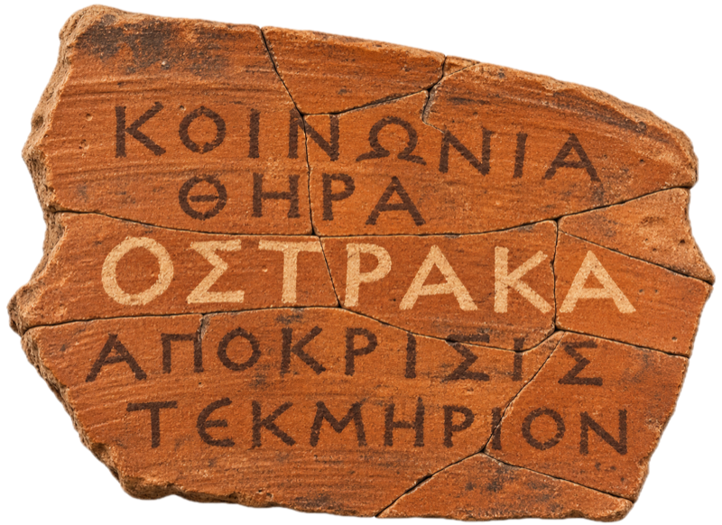
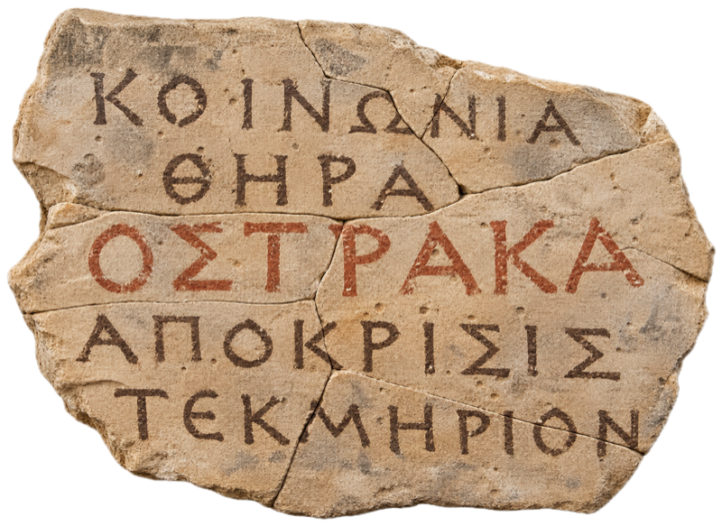

# The Ostraka brand

  
  

## The name

*Ostraka* (Greek ὄστρακα, singular *ostrakon*) are pieces of broken pottery used for writing. In Egypt they were the everyday notepad for centuries: tax receipts, accounts, rotas and letters, from the scribes of Deir el-Medina to the Greek receipts of the Ptolemies. In Athens, citizens scratched a name on one to vote. Egyptologists use the Latin spelling, *ostraca*; *ostraka* is the direct transliteration of the Greek.

That gives the product three meanings in one word: the record, the ledger, and a decision taken by many hands. The broken-and-mended mark adds a fourth: an incident is rebuilt from its pieces, finding by finding.

The letters stand for **O**perational **S**uite for **T**eams to **R**espond, **A**ssess, **K**eep records & take **A**ction. Say it OS-tra-ka.

The product was called ciphr until 10 November 2026. CIPHR Ltd, a UK HR software company, holds registered marks for the name, so it changed before anything was released.

## The mark

A single sherd broken into pieces and glued back together, the joins still showing. The writing runs across the breaks, so it only reads once the pieces are rejoined. The words are what Ostraka does, in Greek that existed 2,400 years ago:

| Greek | Meaning |
|---|---|
| ΚΟΙΝΩΝΙΑ | partnership, working together |
| ΘΗΡΑ | the hunt |
| ΟΣΤΡΑΚΑ | the name, in the second colour |
| ΑΠΟΚΡΙΣΙΣ | the answer, the response |
| ΤΕΚΜΗΡΙΟΝ | conclusive proof: Aristotle's word for evidence that settles a question, which is what a verified finding is |

The letters are evenly spaced, as Athenian inscriptions were cut *stoichedon*, each letter in its own square of a grid. The rounded E in ΤΕΚΜΗΡΙΟΝ is the lunate epsilon, a real letterform on later ostraka.

There are two versions:
- **Clay** (fired terracotta, brown ink, the name in pale slip) in the light theme.
- **Limestone** (a pale flake, brown ink, the name in red ochre, like the Egyptian receipts) in the dark theme.

The mark changes material with the theme, so it always stands out from the page. Below about 48 pixels the photograph turns to mush, so the favicon (`frontend/public/favicon.svg`) is a flat drawn sherd that follows the same rule.

| File | Use |
|---|---|
| `docs/brand/ostrakon-clay.png`, `ostrakon-limestone.png` | Documents, the README (800 px, transparent) |
| `frontend/public/brand/` | Sign-in (560 px) |
| `frontend/public/favicon.svg` | The browser tab, clay or limestone by the OS theme |
| `frontend/public/favicon.png` | Push notifications (clay, 192 px) |

## Sign-in

The sherd sits above a split-flap departures board: limestone tiles in a clay frame. The board flaps through incident words (ALERT, PAYLOAD, LATERAL, ΟΣΤΡΑΚΑ…) and keeps coming back to the name, which settles in red ochre. Malware appears as Egyptian hieroglyphs, the way it reads to anyone who hasn't reversed it, and flickers red. With reduced motion the board holds the name.

## The Ostrakon palette

One of the three palettes in Settings, beside Cobalt (the default) and Ledger. No black anywhere: text is iron-gall brown, the ground is limestone, and fired clay is the accent.

| Token | Light | Dark |
|---|---|---|
| `--bg` | `#f1ede4` limestone | `#1e1612` fired clay at dusk |
| `--surface` | `#faf7f1` | `#271d18` |
| `--ink` | `#33241b` iron-gall | `#efe6d8` |
| `--accent` | `#a0492f` clay | `#e08d6d` |

The departures board's colours (`--board-*`) are an object rather than a surface, so they're the same in every palette and mode. Severity and TLP colours never change with the palette; TLP chips keep the standard black ground.

## Rules

- Records stay records and findings stay findings: the imagery is in the brand, not in the product's words. Nobody should have to know what a sherd is to declare an incident.
- Never use "ostracise" or "ostracism" in copy. It's the one meaning that works against a collaboration tool.
- No Greek-key borders, columns, amphora clip art or laurel wreaths. The mended sherd carries the whole reference.
- Red ochre marks one thing per screen: what needs someone.
- Inter and JetBrains Mono are the product's fonts, in every palette.
- In writing the name is **Ostraka**, capitalised like any product name (11 November 2026); `ostraka` only in paths, commands and identifiers. The wordmark and the board set it in capitals.
- The Greek capitals read as "OΣTPAKA" to anyone who doesn't read Greek (Ρ is an R), so the Latin *ostraka* is the wordmark and the Greek is the second voice: on the mark, on the board and on the about page.
